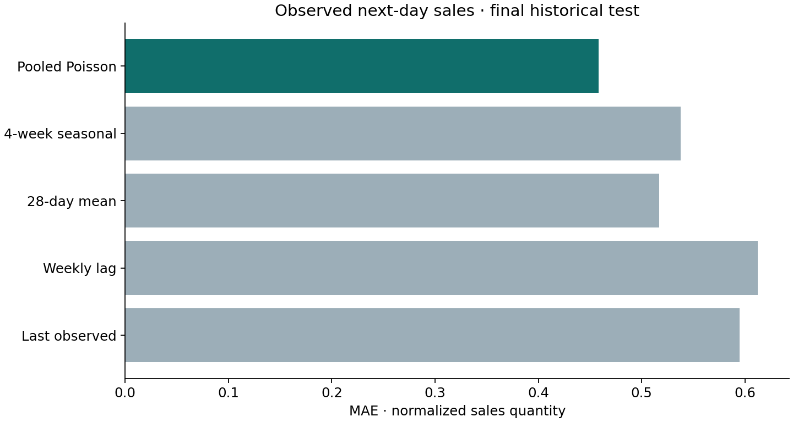
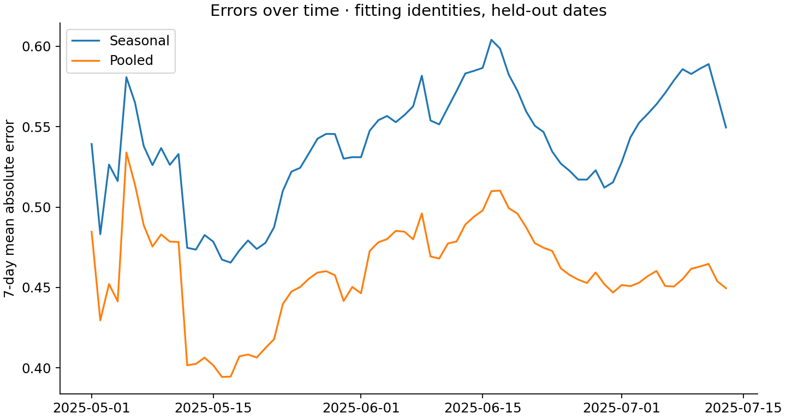

# Research report

## Question and identification boundary

How well can historical sales and stockout information forecast **next-day observed normalized sales**, and what happens when forecasts feed a fully specified capacity simulation? Three exercises are separate: observed-sales forecasting, reconstruction of artificially hidden hourly sales on fully in-stock days, and finite-scenario allocation. None identifies demand that would have occurred during organic stockouts.

A stockout mask indicates potential censoring, not the missing quantity. Actual inventory, replenishment, lost demand, prices, physical units and retailer costs are absent. Observed sales are an explicit proxy in the decision exercise, never organic-demand ground truth.

## Locked protocol and cohort

Original [protocol](../protocol.json) SHA256: `9fba7468115261827064dbc3ebbd00bd1051d4ffcd00986f395c03eb63e8aa0a`. The [weekly-block addendum](../protocol-addendum.json) was separately locked before model scores; the original freeze is preserved. A valid negative result was acceptable.

Eligibility uses only dates and identities through 2024-12-31: at least 180 observations, including at least 60 in October–December 2024. Among 8,849 eligible series, the 1,024 smallest SHA256 hashes of `stockout-v1|store_id|product_id` define the cohort. Hash modulo five reserves 193 identities from every fit and calibration. No future-survival or outcome filter replaces identities.

| Role | Dates | Use |
| --- | --- | --- |
| Fit | 2023-06-05–2024-12-31 | 356,925 usable rows; 831 fitting identities |
| Validation | 2025-01-01–2025-02-28 | MAE-only point-model selection |
| Calibration | 2025-03-01–2025-04-30 | One interval expansion scalar; 44,553 rows |
| Final historical | 2025-05-01–2025-07-13 | 74 dates; 10 full disjoint weeks and 4 remaining days |
| Official external | 2025-07-14–2025-07-20 | Short seven-day external check |

The model is fixed across origins; prior-day observed lags update. This is rolling **one-day-ahead** forecasting, not fixed-origin seven-day prediction. Identity holdout retains history for features and tests transfer with history, not cold start. Research scoring requires 14 historical observations; service additionally withholds histories whose latest observation is over two days old. Only two final research rows fail that extra service rule; eligibility is therefore slightly stricter in the service.

| Group / split | Selected identities | Observed identities | Usable rows / calendar opportunities |
| --- | --- | --- | --- |
| fitting_identities / final | 831 | 684 | 44,693 / 61,494 |
| fitting_identities / official_external | 831 | 531 | 3,717 / 5,817 |
| transfer_holdout / final | 193 | 158 | 10,435 / 14,282 |
| transfer_holdout / official_external | 193 | 125 | 875 / 1,351 |

Missing calendar days are never zero-filled. At least 14 observations in the previous 28 days are required for scoring. Results are conditional on observed usable rows. Only 656 of the initial 1,024 identities survive into the external week. Long-history eligibility and attrition limit generalization.

## Contracts, features and models

Both source hashes, all 19 field types, key uniqueness, finite numeric/array values, daily/hourly quantity conservation and business-hour stock counts were checked across 7,939,549 rows. All passed. The 634,383 selected records were separately parsed as typed events and durably ingested; no quarantines occurred. Their normalized-sales total is 986,086.396, conserved within 1.2e-10. [Source audit](../artifacts/source_audit.json); [ledger receipt](../artifacts/ledger_ingestion_receipt.json).

The 21 features use past sales and stockout hours, missingness/history coverage and target calendar harmonics. Lags are 1, 7, 14 and 28 calendar days; windows are 7 and 28 days. Scale is max(trailing-28-day mean, 0.1), used to normalize target and lag summaries, with log scale also a feature. Future realized weather, discounts, activity and stock status are excluded. Future stockout masks are diagnostic strata only.

Four baselines are last observation, weekly lag with mean fallback, 28-day mean and the average of four prior matching weekdays. Fixed HistGradientBoosting models use 160 iterations, 15 leaves, learning rate 0.05, minimum leaf size 40, L2 penalty 3, seed 42 and no early stopping. Poisson loss is a mean-model/quasi-likelihood choice for non-integer normalized quantities, not a validated count distribution. Quantile 0.1 and 0.9 models use the same settings. No final-outcome tuning occurred.

Quantile crossing is removed by sorting. CQR uses score max(lower−y, y−upper) and the ceil((n+1)×0.8)-th calibration score, expanding endpoints and clipping lower at zero. Realized expansion is 0.000216. Temporal dependence, shared series shocks and shift prevent an automatic exchangeability coverage guarantee.

Point selection used only validation MAE: pooled 0.4264 versus seasonal 0.5144. Calibration does not affect that choice. Validation CQR coverage was suppressed because March–April calibration was unavailable in January–February. Calibration coverage is an in-sample diagnostic; final/external intervals are holdouts.

## Forecast evidence

| Model | Final MAE | Final WAPE |
| --- | --- | --- |
| Last observed | 0.5950 | 38.46% |
| Weekly lag | 0.6123 | 39.57% |
| 28-day mean | 0.5170 | 33.41% |
| Four-week seasonal | 0.5378 | 34.76% |
| Pooled Poisson loss | 0.4585 | 29.64% |

| Evaluation | Rows | Pooled MAE | Seasonal MAE |
| --- | --- | --- | --- |
| validation / fitting_identities | 44,856 | 0.4264 | 0.5144 |
| validation / transfer_holdout | 10,425 | 0.4699 | 0.5603 |
| final / fitting_identities | 44,693 | 0.4585 | 0.5378 |
| final / transfer_holdout | 10,435 | 0.5492 | 0.6454 |
| official_external / fitting_identities | 3,717 | 0.4318 | 0.4902 |
| official_external / transfer_holdout | 875 | 0.4517 | 0.5226 |

Final pooled MAE is 14.7% lower than seasonality and 11.3% lower than the best simple baseline. Final nominal-80% interval coverage is 80.45%, mean width 1.4521. The pooled model beats seasonality in 10 of 10 full disjoint weeks and is best of all five models in 9. Aggregate coverage is not a per-window guarantee.

The predeclared exploratory bootstrap first averages paired errors within dates, then resamples contiguous seven-day blocks, preserving within-day dependence across series. With 500 draws, pooled-minus-seasonal daily-average MAE is -0.0802, with 95% percentile interval [-0.0927, -0.0697]. Row-weighted and day-weighted differences differ slightly because attrition changes daily sample sizes. This is descriptive under the resampling scheme, not a universal significance or causal claim.

[All metrics and stockout strata](../artifacts/forecast_metrics.csv) · [Weekly blocks](../artifacts/weekly_metrics.csv) · [Intervals](../artifacts/interval_metrics.json) · Row-level results are generated locally and excluded from the public distribution.

## Artificial hourly masking

A pooled business-hour profile is estimated from 194,840 fully in-stock fit-period rows of fitting identities. On final days whose 06:00–21:59 stockout vector is zero, hide the final four or eight hours and recover the known full business-hour subtotal. Compare zero filling, uniform exposure scaling and learned-profile scaling.

| Hidden final hours | Method | Final MAE |
| --- | --- | --- |
| 4 | zero_fill | 0.2410 |
| 4 | uniform_exposure | 0.2630 |
| 4 | training_hourly_share | 0.1640 |
| 8 | zero_fill | 0.7239 |
| 8 | uniform_exposure | 0.4295 |
| 8 | training_hourly_share | 0.4007 |

The profile helps this artificial task. Uniform exposure is worse than zero filling when only the last four hours are hidden, demonstrating possible overcorrection. Selection into fully in-stock days and artificial mask placement differ from organic stockouts. These scores do not validate organic lost-sales estimates.

## Finite-grid capacity simulation

For each final date, use the first eight available fitting identities in the locked hash order. Quantity increments are 0.1; caps are min(100, ceil(1.5×max(raw q90, 0.1)/0.1)) increments. Capacity is floor(0.8×sum(max(trailing mean, 0.1))/0.1). Scenario cost is shortage_weight×max(d−q, 0)+max(q−d, 0).

The assumed finite distribution puts equal mass on raw learned q10, the selected point/mean forecast and raw learned q90. Equal masses are assumed, not implied by quantile levels. **Protocol deviation:** the freeze called the middle scenario q50; no median model was fit. All results use a selected-point scenario, with no refit or outcome-driven tuning to hide this deviation.

Exact recurrence: `V_i(b)=min_q[V_(i−1)(b−q)+L_i(0.1q)]`, with integer q between zero and its cap. Final minimization permits unused capacity; backtracking returns quantities. This is globally optimal for the declared finite grid and scenario objective. Twelve randomized small cases match an independent exhaustive oracle. Every solution is checked for feasibility and objective reconstruction.

| Shortage : excess | Scenario DP | Proportional point | Hindsight oracle |
| --- | --- | --- | --- |
| 1 : 1 | 5.7136 | 5.5464 | 3.9704 |
| 3 : 1 | 15.2409 | 15.2942 | 11.9104 |
| 5 : 1 | 24.7682 | 25.0420 | 19.8501 |

These are mean realized **proxy** costs over 74 dates, evaluated against observed sales. The scenario rule slightly improves on proportional allocation at shortage weights 3 and 5 and loses at 1. The hindsight grid oracle is unattainable prospective information and supplies only a same-grid lower bound. There is no uniformly winning allocation result or retailer-savings claim.

For identical continuous caps/capacity, rounding a feasible continuous solution down preserves feasibility and increases loss by at most shortage_weight×0.1 per item. The conservative eight-item bound is 2.4 at weight 3; it does not bound real retail loss.

The final API uses `raw-quantile-point-grid-v1`, with the same scenario and cap definition. An initial CQR-endpoint service mismatch was preserved in the audit trail before correction. Offline-versus-HTTP checks now verify exact-request scenarios, caps, quantities and objective. Historical eight-item results do not establish performance for other portfolios or assumptions.

## Maturity and limitations

The complete serving identity binds fitted bytes, selected point model, calibration and source/feature metadata plus implementation digests. Current version is `9d74170418437ab8`. Systems fixes do not refit the model. These tables use the separately executed Linux reference; the historical Windows outputs and their numerical differences are recorded in [REPRODUCIBILITY.md](REPRODUCIBILITY.md).

Original arrival timestamps are absent. Next-midnight, late-arrival and fault schedules are synthetic. They support a declared information schedule and systems tests, not empirical arrival-latency claims. No actual inventory, physical capacity, costs, lead times, prices or operational feedback are available. The sample is bounded, attrition is substantial and the external week is short. This is an executed single-machine research prototype, with no production, cloud, client-impact or personal-mastery claim.
