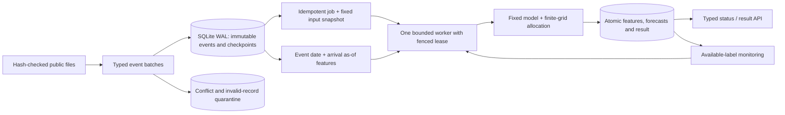

# System design

## Durable state

Sources have immutable hash-linked manifests and projected-stream checkpoints. Events have one immutable fact per store/product/date. Canonical typed-payload matches are duplicates; divergent content under a key is quarantined. Each batch commits events, quarantines, counts and checkpoint in one `BEGIN IMMEDIATE` transaction. Received = accepted + duplicates + quarantined. Reusing a batch ID with changed content conflicts. Checkpoints refer to deterministic cohort-stream offsets, not parquet physical row numbers. Mutable upstream corrections need an explicit revision policy; this application never silently overwrites facts.

A job stores a canonical spec, idempotency key, model/feature versions and maximum committed event sequence at submission. Later backfills cannot alter that snapshot. The complete monitoring summary is also frozen inside the submission transaction, filtered to that model and feature version; later publications cannot change the job's fallback policy on retry. Active queue length is capped at 256, with at most 64 unique series per job. No request handler trains a model or performs inference.

The worker claims jobs transactionally and receives an incrementing lease token. Publication requires current owner, token and unexpired lease; stale workers cannot publish. The default lease is 30 seconds. Abandoned running jobs become eligible after expiry. Features, forecasts, result JSON and success state commit together. This is at-least-once computation with one fenced publication per job, not a global exactly-once distributed claim.

## Time and policy

Synthetic arrivals cannot precede completion of a daily event. Original arrival logs are absent: next UTC midnight is an assumption, not a measured retailer timestamp. Features require event date before target, arrival no later than as-of, and event sequence no later than the submission snapshot. As-of must be on target date. The fitted/calibrated artifact is unavailable before 2025-05-01.

Normal output requires at least 14 observations in the last 28 days and a latest observation no more than two days old. Seven to thirteen observations trigger seasonal fallback. Fewer than seven or stale data restrict prediction. Fallback/restricted cases cannot allocate capacity.

Monitoring joins labels only when arrival is available as-of and deduplicates repeated forecasts for the same series/date. At least 30 unique labelled intervals are needed. Coverage below 60% triggers seasonal fallback and restricts allocation. This is a demonstration policy threshold, not a statistically validated drift detector.

The final allocation policy ID is `raw-quantile-point-grid-v1`: equally weighted raw q10, selected point/mean and raw q90, with frozen q90-based grid caps. The assigned masses are assumptions, not calibrated probabilities. API and offline allocations are tested against the same scenario matrix, caps and objective.

## API and limits

| Route | Behavior |
| --- | --- |
| GET `/health` | Local readiness and active model |
| GET `/v1/models` | Hash-linked trusted model manifest |
| GET `/v1/contracts/event` | Event JSON Schema |
| POST `/v1/batches` | Up to 1,000 records; typed validation, quarantine, checkpoint |
| POST `/v1/jobs` | Typed one-day job; required Idempotency-Key; 202 response |
| GET `/v1/jobs/{id}` | Durable state, attempts, versions and snapshot |
| GET `/v1/jobs/{id}/result` | Typed atomically published result |
| GET `/v1/metrics?as_of=...` | Ledger counts and available-label monitoring |

The ASGI boundary rejects bodies over 1 MiB, including streamed bodies without reliable Content-Length. Quantities must be finite, IDs nonnegative, hourly arrays length 24, stock masks binary, totals conserved and timestamps timezone-aware. Unknown fields are forbidden. Conflicting keys/checkpoints/models fail explicitly; queue overflow returns 429. Results pending publication return 409.

## Executed evidence

44 tests passed. Four abrupt publication-process exits recovered semantically identical outputs to a clean run on version 509b40e9d63ead14. The subsequent fail-only fencing repair is checked by the final regression suite and current-version HTTP smoke; no model fit changed. One-second test leases recovered before-commit failures in 0.985–1.012 seconds after exit; after-commit results required no recomputation. Default application leases remain 30 seconds.

Real HTTP used 20 excluded warm-ups and 200 measured single-series jobs, four clients, one worker and two numerical threads. End-to-end p50/p95/p99: 283.3/457.6/506.3 ms. Throughput: 13.54 jobs/s. Peak sampled aggregate server-tree RSS: 178.8 MiB; summed working sets may double-count shared pages. Client memory and whole-host peak are excluded. The shared Windows host exposes 8 logical CPUs and 7.75 GiB RAM.

Predeclared local thresholds were request p95 ≤250 ms, job p95 ≤2,000 ms, zero errors and server RSS <1,500 MiB. All passed for this small warm repeated-history workload. Direct model-only timings exclude queue, durability and HTTP and are labelled separately. No cloud, sustained-load or production guarantee follows.

## Security and operations

Bind to IPv4 loopback only; authentication and TLS are absent. SQL values are parameterized. The served model identity binds the pickle, calibration/selection configuration and normalized-text digests of feature, model, policy, ledger and API implementations. Manifest-only or runtime-implementation changes are rejected. Trusted bundled pickle is hash-checked before deserialization; a digest detects corruption but does not authenticate an attacker who replaces both model and manifest. No request supplies a model path. Dependency closure is pinned, `pip check` passed, and static checks found no shell=True calls or high-specificity secret patterns. The local dependency receipt does not itself claim a vulnerability-database audit.

SQLite WAL/FULL protects local transaction boundaries. Backups, disk exhaustion, operating-system failure and multihost coordination require additional work. Structured logs contain run IDs, event classes, checkpoint counts and versions, not entire raw event payloads. Reproduction creates runtime files under the chosen runtime directory.

[Source schema](source_schema.json) · [Event schema](event.schema.json) · [Job schema](job.schema.json) · [Result schema](result.schema.json) · [Benchmark](../artifacts/benchmark.json) · [Recovery](../artifacts/recovery_receipt.json).
