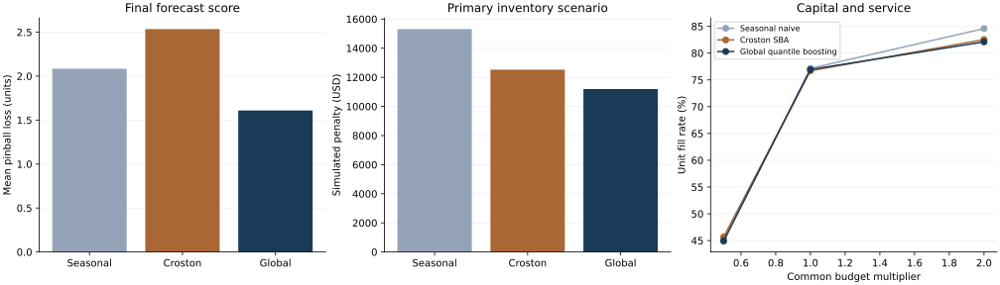

# Forecast accuracy and constrained inventory decisions

17 October 2026. Historical M5 research case. Final evaluation is frozen; there is no live replenishment deployment.

## Findings

The fixed global model has final mean pinball loss 1.609013, versus 2.534997 for the development-selected croston_sba baseline: 36.53% lower. The paired difference is -0.925984, with a two-origin moving-block bootstrap 95% interval [-1.261740, -0.619088]. This conditions on the fitted models and fixed sample. Only 15 weekly origins support the comparison; 210 correlated series are not 210 independent experiments.

Forecast and operating rankings differ among the baselines: seasonal naive has lower final pinball loss than Croston, while Croston has lower simulated holding-plus-lost-sales penalty in the primary operating case. The global model is best on both metrics in that case. This is an observed result of the fixed analysis, not a requirement imposed on model selection.

The global model’s primary simulated penalty is USD 11,194.18, 10.64% below the selected baseline. Its unit fill rate is 76.95%; seasonal naive’s is 77.16%. Lower penalty therefore does not mean highest service. None of these amounts is measured retailer savings or achieved commercial profit.

## Data and information timing

The M5 organizers’ public research/replication collection is mirrored by Nixtla. The sample is the first 10 lexical item IDs per department, crossed with CA_1/TX_1/WI_1: 210 series, 70 items, seven departments and 1,941 daily observations from 2011-01-29 to 2016-05-22. No sales or test-performance filter selects the sample. Source sales are nonnegative integer units; 72.74% are zero. Zero sales may reflect intermittency, launch timing or stockouts; they are not identified latent demand.

Nixtla’s mirror omits the competition id/calendar d columns. The pipeline explicitly constructs item__store keys and sequential day labels; no unit values are changed. All ZIP members are read through CRC verification and hashed. The cached subset, source/member hashes and exact build recipe support recovery. Research/replication access does not establish an unrestricted raw-data redistribution or commercial-use license. Source observations are not relicensed as code.

Each forecast origin is the last observed day; the target is the following 14 days. Training origins 364–1596, calibration 1624–1715, development 1743–1799 and final 1827–1925 are all 7 days apart. Boundaries leave labels from each earlier phase before the next. Final 14-day targets overlap; the operating simulator consumes nonoverlapping 7-day review periods. The summed 14-day target count is not a unique 105-day sales total.

Only observed sales lags, deterministic date features, item/department/store IDs and the last completed-week price are used. Every origin is checked against the source price-week calendar so that the week’s average price is complete. No future realized prices, promotions, SNAP schedules or unknown events enter. Prices are forward-filled only, never backfilled. Model imputation uses the training median, with a missing-price flag; operational ordering never invents a missing procurement cost. All final-origin prices are observed.

## Fixed models and decision

Seasonal naive predicts twice the previous 7-day total. Croston SBA uses alpha 0.1, initial positive size and the initial interval including preceding observed zeros; later updates occur only on positive sales. Each distributional baseline adds department-pooled calibration residual quantiles, scaled by max(last 28 day total/2,1). Calibration origins are separate from fitting/development/test.

The challenger has four direct global histogram gradient boosting models at quantiles 0.1/0.5/0.8/0.9, with 150 iterations, 15 leaves, minimum 50 rows/leaf, learning rate 0.08, L2=5, max_bins=128 and no early stopping/search. Categorical vocabularies and price imputation are fixed from training. Each model is fitted once for the original comparison; final forecasts update lagged observed features without refitting weights. Quantiles are sorted and clipped at zero before evaluation, as specified before fitting.

Raw quantile crossing occurred in 7.30% of development and 4.29% of final forecasts. Reported scores and calibration are after the fixed coherence correction. No hierarchy reconciliation is performed.

Croston was selected among baselines by development pinball loss. The global challenger then beat that selected baseline on development and was frozen as the forecast choice. Final results do not switch the comparator to the test-best baseline or tune the challenger. Models, calibration, predictions, protocol and inputs are hash-guarded before final scoring.

| Model | Development pinball | Final pinball | Final median MAE | Final WAPE | 80% interval coverage | .8 quantile empirical fraction |
|---|---:|---:|---:|---:|---:|---:|
| Croston SBA + residual quantiles | 2.2119 | 2.5350 | 6.7801 | 64.83% | 77.75% | 80.13% |
| Global quantile boosting | 1.7938 | 1.6090 | 4.4375 | 42.43% | 88.98% | 78.38% |
| Seasonal naive + residual quantiles | 2.3904 | 2.0837 | 5.6803 | 54.31% | 78.60% | 79.49% |

The global 80% interval covers 88.98% in this discrete, zero-heavy sample; exact 80% calibration is not established. The .8 quantile covers 78.38%. Inspect interval width and store/department diagnostics in final.json. Marginal interval coverage does not guarantee joint coverage or service levels. No official M5 leaderboard score/rank is claimed: this uses a different sample, horizon and scoring rule.

## Operating policy and constraints

Review weekly with one-week delivery delay. Order toward the forecast 0.8 quantile of 14-day sales, net of onhand and outstanding orders, using integer units. Start empty with no free stock. Receive the prior order at the next review; unmet sales are lost, not backlogged. Source sales serve as the demand proxy.

Assumed procurement cost is 0.6 times the last completed-week selling price; holding penalty 0.1 times that price per ending unit/week; lost-sales penalty 0.4 times it per missed unit. These costs, the delivery delay, budget and capacity are hypothetical. Procurement spend is separate from the penalty objective. Ending inventory/pipeline are reported, not converted into profit.

The budget is an exogenous multiplier of trailing 28 day average weekly procurement spend and is identical across models. Capacity is twice trailing weekly unit volume. Desired orders are allocated greedily by shortage-penalty/unit-cost, lower inventory coverage, then stable ID. This is a fully specified constrained policy, not a globally optimal inventory allocation. No future demand enters its priorities.

| Scenario / model | Simulated penalty (USD) | Unit fill | Procurement spend (USD) | Ending stock | Ending pipeline |
|---|---:|---:|---:|---:|---:|
| budget_double / Croston SBA + residual quantiles | 11,777.15 | 82.54% | 31,499.77 | 1,516.00 | 1,047 |
| budget_double / Global quantile boosting | 10,727.11 | 82.11% | 31,102.90 | 1,390.00 | 1,398 |
| budget_double / Seasonal naive + residual quantiles | 15,219.79 | 84.59% | 34,570.03 | 2,384.00 | 1,480 |
| budget_half / Croston SBA + residual quantiles | 16,747.87 | 45.67% | 16,117.01 | 673.00 | 692 |
| budget_half / Global quantile boosting | 16,317.01 | 44.95% | 16,116.79 | 721.00 | 681 |
| budget_half / Seasonal naive + residual quantiles | 18,019.97 | 44.85% | 16,116.57 | 996.00 | 651 |
| censor_proxy / Croston SBA + residual quantiles | 12,234.99 | 76.78% | 30,071.09 | 1,373.44 | 1,111 |
| censor_proxy / Global quantile boosting | 10,764.45 | 76.94% | 29,683.07 | 1,202.31 | 1,241 |
| censor_proxy / Seasonal naive + residual quantiles | 14,814.50 | 76.69% | 31,558.61 | 2,059.62 | 1,231 |
| lead_two_weeks / Croston SBA + residual quantiles | 13,608.20 | 62.35% | 25,160.31 | 1,069.00 | 1,623 |
| lead_two_weeks / Global quantile boosting | 13,309.70 | 60.84% | 24,489.85 | 962.00 | 1,962 |
| lead_two_weeks / Seasonal naive + residual quantiles | 16,227.83 | 64.93% | 28,093.92 | 1,962.00 | 1,817 |
| primary / Croston SBA + residual quantiles | 12,526.51 | 76.70% | 29,523.77 | 1,473.00 | 1,066 |
| primary / Global quantile boosting | 11,194.18 | 76.95% | 29,274.02 | 1,308.00 | 1,251 |
| primary / Seasonal naive + residual quantiles | 15,314.39 | 77.16% | 31,376.70 | 2,229.00 | 1,188 |
| shortage_high / Croston SBA + residual quantiles | 17,407.27 | 76.70% | 29,523.77 | 1,473.00 | 1,066 |
| shortage_high / Global quantile boosting | 16,017.75 | 76.95% | 29,274.02 | 1,308.00 | 1,251 |
| shortage_high / Seasonal naive + residual quantiles | 20,150.10 | 77.16% | 31,376.70 | 2,229.00 | 1,188 |
| shortage_low / Croston SBA + residual quantiles | 10,086.13 | 76.70% | 29,523.77 | 1,473.00 | 1,066 |
| shortage_low / Global quantile boosting | 8,782.40 | 76.95% | 29,274.02 | 1,308.00 | 1,251 |
| shortage_low / Seasonal naive + residual quantiles | 12,896.53 | 77.16% | 31,376.70 | 2,229.00 | 1,188 |

All 15 weeks and post-startup penalties are retained in final.json. The first week starts empty, so all policies miss its demand; this is disclosed rather than hidden with free initial inventory. The two-week-lead-time scenario deliberately leaves the 14-day policy target unchanged and is a misspecification stress, not a reoptimized policy. The censoring proxy increases zero-sale weeks’ demand by 25% of trailing weekly sales; it cannot recover true stockouts. Shortage-cost and budget sensitivities retain their stated assumptions. The final operating rankings are descriptive and do not select a new model after seeing test outcomes.

## Verification and limits

Nine unit tests cover SBA known sequences, exact target boundaries, future sales/price feature invariance, quantile scoring/coherence, cash/capacity/integer constraints, missing-cost abstention, arrival delay, stock conservation, tighter budgets and censor/lead-time checks. Final verification recomputes all global predictions from the frozen model, bitwise-identical; reconciles pinball losses with scikit-learn; perturbs all future sales/prices at three final origins; and checks budgets, capacities and stock/pipeline conservation in all 21 model/scenario runs. All eleven source/model freeze hashes pass before and after final scoring.

Bootstrap draws resample two-week origin blocks with all series together, not independent item rows. Fifteen origins and a fixed sample limit external validity; the interval conditions on training/calibration and does not include retraining or sample selection. Operational metrics are deterministic simulations, with no confidence interval claimed for an actual retailer. No observed stock, replenishment, costs or stockout labels are available.

## Recruiter explanation

Built a forecast-to-order pipeline with explicit information timing, four global quantile models, a locked future evaluation and dependence-aware uncertainty. Demonstrated why forecast accuracy, service and simulated cost can rank policies differently under common capital/capacity constraints. Added failure scenarios and an offline budget explorer; empirical sales and hypothetical operating assumptions remain distinct.

Evidence: [data audit](data_audit.json), [development](development.json), [model freeze](model_freeze.json), [final results](final.json), [verification](verification.json), [protocol](../PROTOCOL.md). Versioned release and actual-browser evidence are recorded in docs/RELEASE.md.
